# Agent Tasks UI

The web interface for [agent_coordinator](https://github.com/tristan00/agent_coordinator). It shows the coordinator's board of tasks, each task's history and attempts, the plan as a graph, every planner session turn by turn, analytics, and the coordinator's settings. It is a React app served by the coordinator itself and talks to it only through the coordinator's HTTP API, on the same origin.

The screenshots below come from two recent boards.

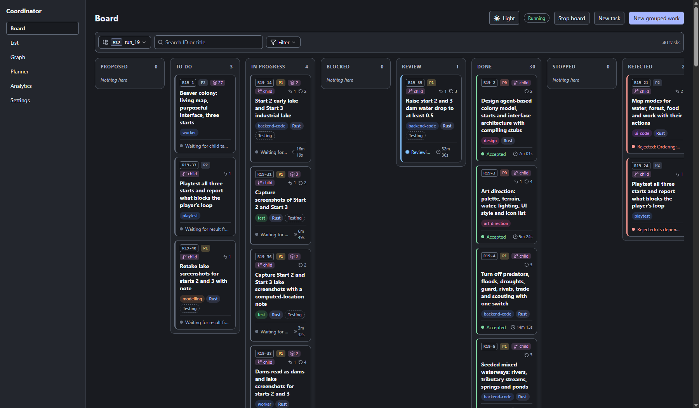

## Views

### Board

Tasks in columns by status: **Proposed**, **To do**, **In progress**, **Blocked**, **Review**, **Done**, **Stopped** and **Rejected**. Each card shows:

- the task's short id, priority, and whether it is a container (with its child count) or a child task
- how often the plan evaluator kicked it back and how many attempts it has had
- its title, role, languages and functions
- what it is doing or waiting for right now, and how long it has been working

Running tasks have an animated border. The header can stop or resume the whole board and create a task or a grouped batch of tasks. The toolbar picks a workspace, searches by id or title, and filters by status, role and other fields.

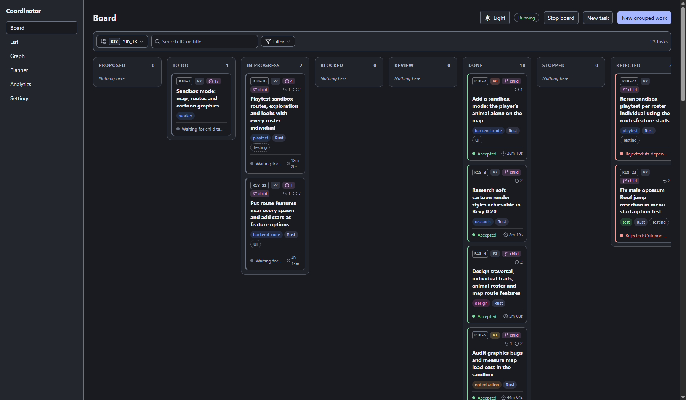

### Task panel

Click any card to open its panel:

- **Outcome** and **acceptance criteria**, each marked passed or not
- **Working, lead and waiting time**, attempts, tokens, and the definition's word count against the workspace limit
- **Plan evaluation**: every evaluator verdict, with its findings for each kick-back
- **Feedback for next attempt**: what the last reviewer or worker said to fix
- **Properties**: role, priority, size, artifact, languages, functions, capabilities, model and grouping
- **Relationships**: what the task needs results from, what needs it, its parent and children, each with live status
- **Attempts**: every implementation, review, merge and replan run, with its model, duration, tokens, result summary and findings, and a link to its log

From the panel you can edit a task that is not running, stop or resume it, ask for a replan, or archive it.

| | |
|---|---|
| 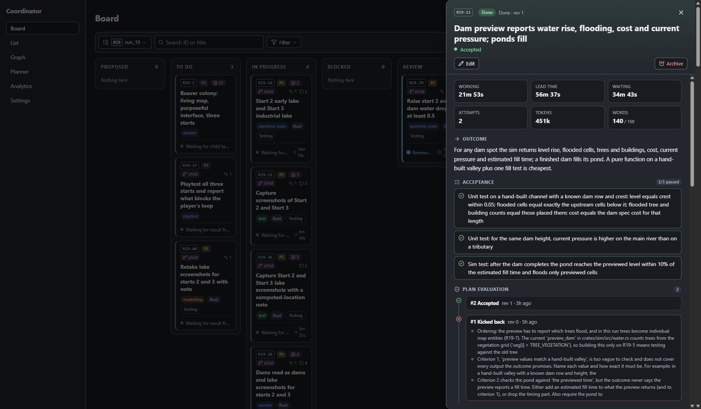 | 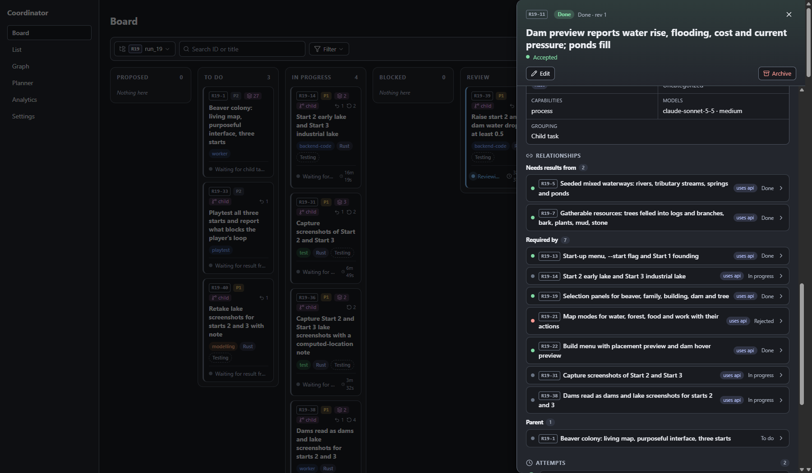 |
| 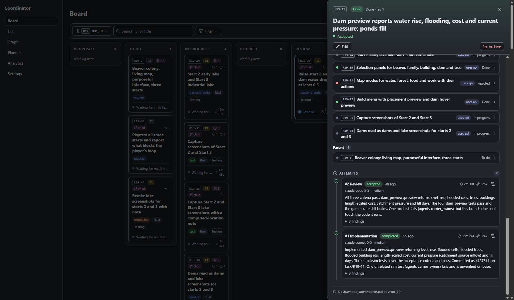 | 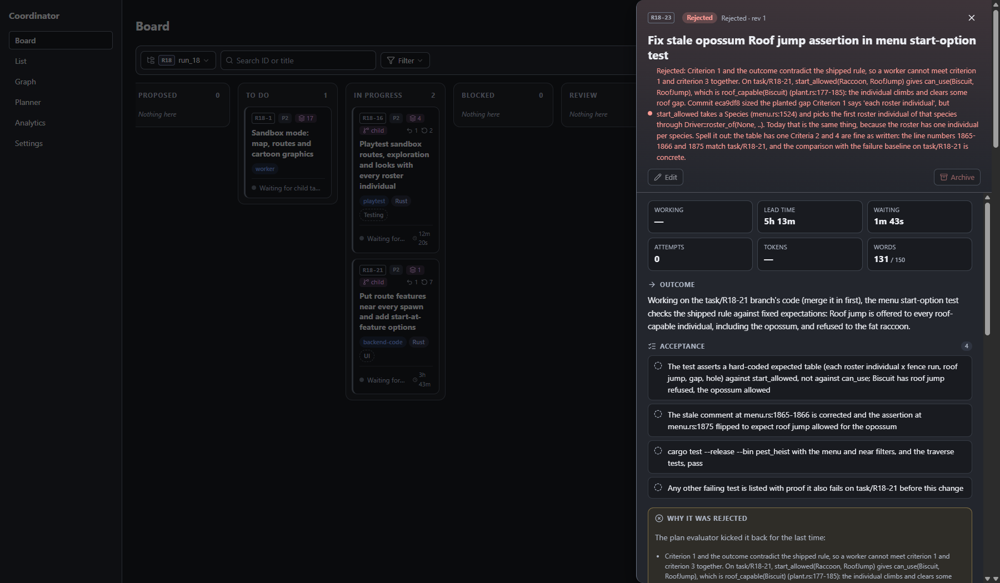 |

A task the plan evaluator rejected shows why at the top, together with the criteria it was proposed with.

### List

The same tasks as a table, with status, role, languages, functions, execution capabilities, what each task is blocked by, and its current state.

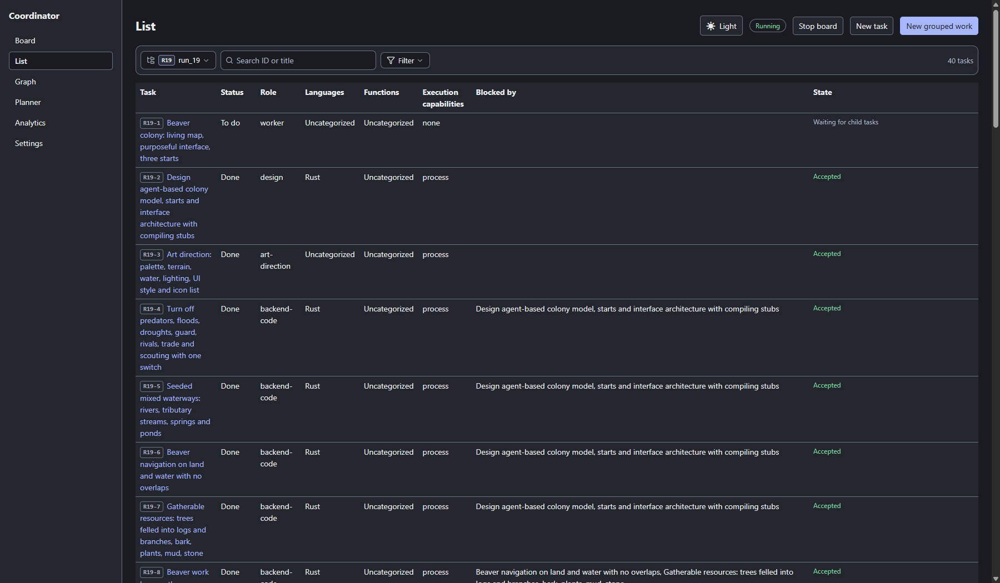

### Graph

The plan as a graph: containers and their children, dependencies, ordering, conflicts and related tasks, each drawn with its own line style. Nodes are coloured by status or another field, and finished work can be hidden. Layout is top-down or force-directed, with a minimap, zoom and fit controls. **Inspect relationships** lists every edge with its endpoints and labels.

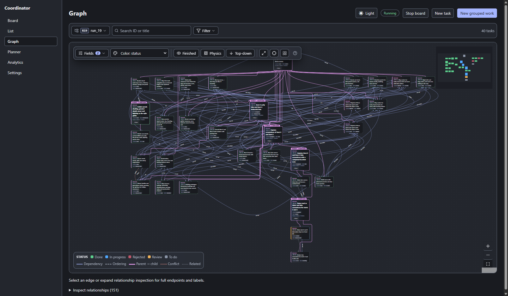

### Planner

Every planner session, newest first. For the selected session:

- elapsed time, turns, cost, board actions, rejected API calls and plan kick-backs
- each request (the initial one, follow-ups and coordinator wake-ups) and its turns
- each turn's steps: messages, board actions such as tasks created or edited, rejected calls with the coordinator's error, other tool calls and thinking, each of which can be shown or hidden
- the end-of-turn summary
- every plan evaluation, with how many tasks it accepted or kicked back and what it cost

**Follow live** streams the current turn. **Open request** shows the full prompt, **Send follow-up** gives a finished session a new request, and **Stop session** stops it and its tasks.

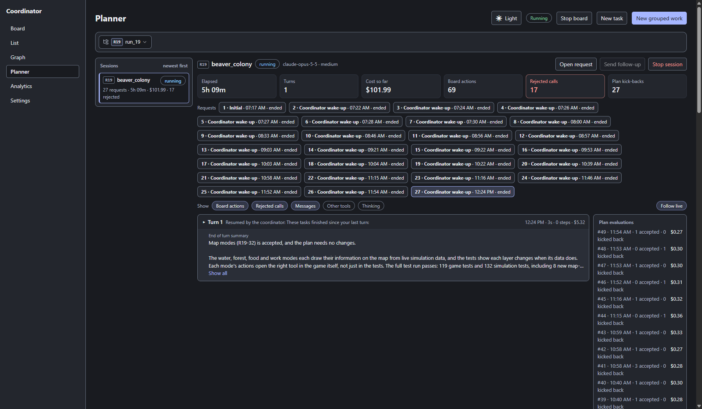

The first turn of a session shows the plan being built. In this one the planner's first batch was refused with every problem listed at once, and the corrected batch created 24 tasks.

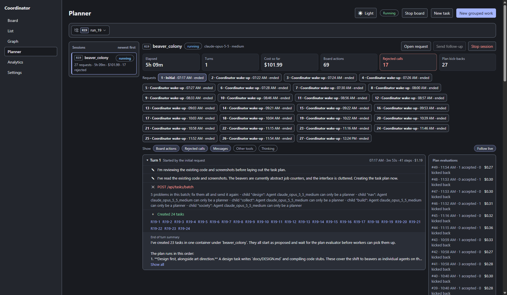

### Analytics

Outcomes grouped by role, size, priority, needs, artifact, number of criteria, relations, container or workspace: task count, first-pass rate (done tasks whose first implementation and first review both succeeded), attempts, review rejections, replans and lead time.

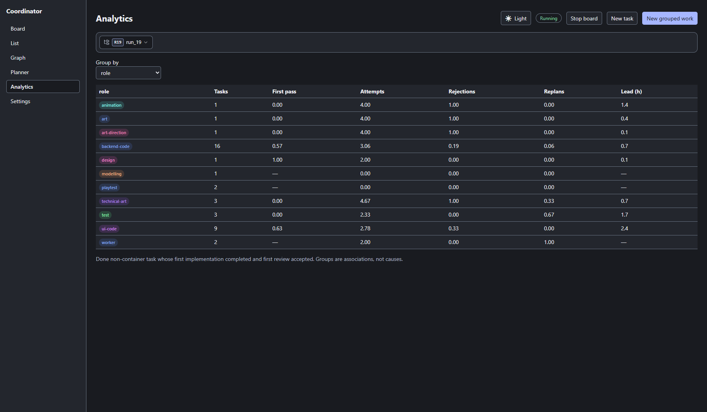

### Settings

Edit the coordinator configuration: the worker command for each stage, the capabilities those workers provide, and an optional notify command that receives held, usage-limit and deploy events as JSON on stdin. Below it is the running build's deployment state.

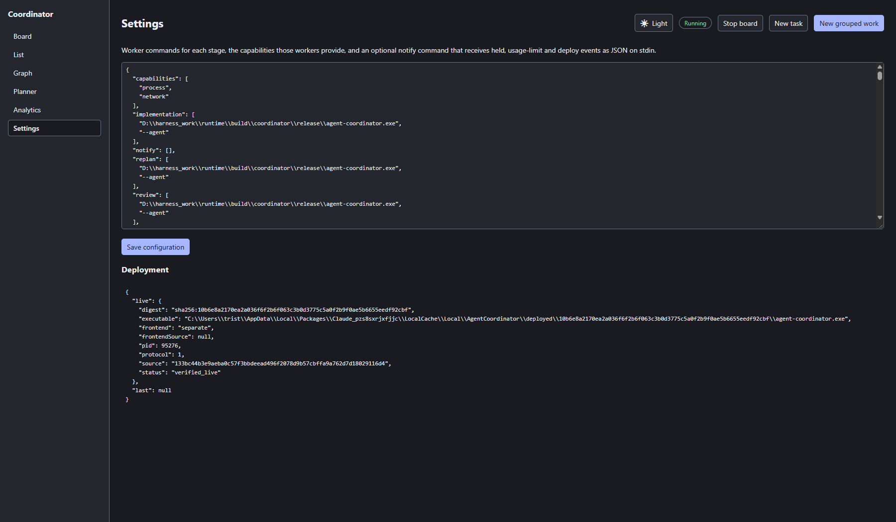

## Build and deploy

Requires Node.js and pnpm, and a running coordinator.

```bash
pnpm install
```

```bash
pnpm run deploy
```

`pnpm run deploy` builds the app with Vite into `dist/` (`index.html`, `app.js`, `style.css`) and asks the coordinator for its data directory. It then copies the build into `<data directory>/ui/<sha256>/`, makes that version current, and checks that the coordinator now serves exactly those files. Set `COORDINATOR_URL` to deploy to a coordinator that is not at `http://127.0.0.1:4242`.

Open the coordinator's address in a browser to use the UI. The theme toggle in the header switches between dark and light.

## How it talks to the coordinator

- `GET /api/state` loads the whole board, and the UI polls it every 1.5 seconds.
- Task actions use `POST`, `PATCH` and `DELETE` on `/api/tasks`, and new grouped work uses `POST /api/tasks/batch`.
- The planner view reads `/api/sessions` and each request's transcript from `/api/sessions/{id}/requests/{n}/events`.
- Analytics reads `/api/analytics`, and settings use `PUT /api/config` and `GET /api/deployment`.

See the coordinator's README for the full API.

## Project layout

| File | Contents |
|---|---|
| `src/main.jsx` | App shell, board, list, analytics, settings and the task and batch editors |
| `src/Task.jsx` | Task cards and the task panel |
| `src/Graph.jsx`, `src/layout.js`, `src/routing.js`, `src/edges.js` | Graph view, layout and edge routing |
| `src/Planner.jsx` | Planner sessions and transcripts |
| `src/Controls.jsx`, `src/Activity.jsx`, `src/TaskName.jsx` | Toolbar controls and shared pieces |
| `src/fields.js` | Task fields, phases and timing used across views |
| `src/style.css`, `src/redesign.css` | Styles |
| `scripts/deploy.mjs` | Build and install into the coordinator |
